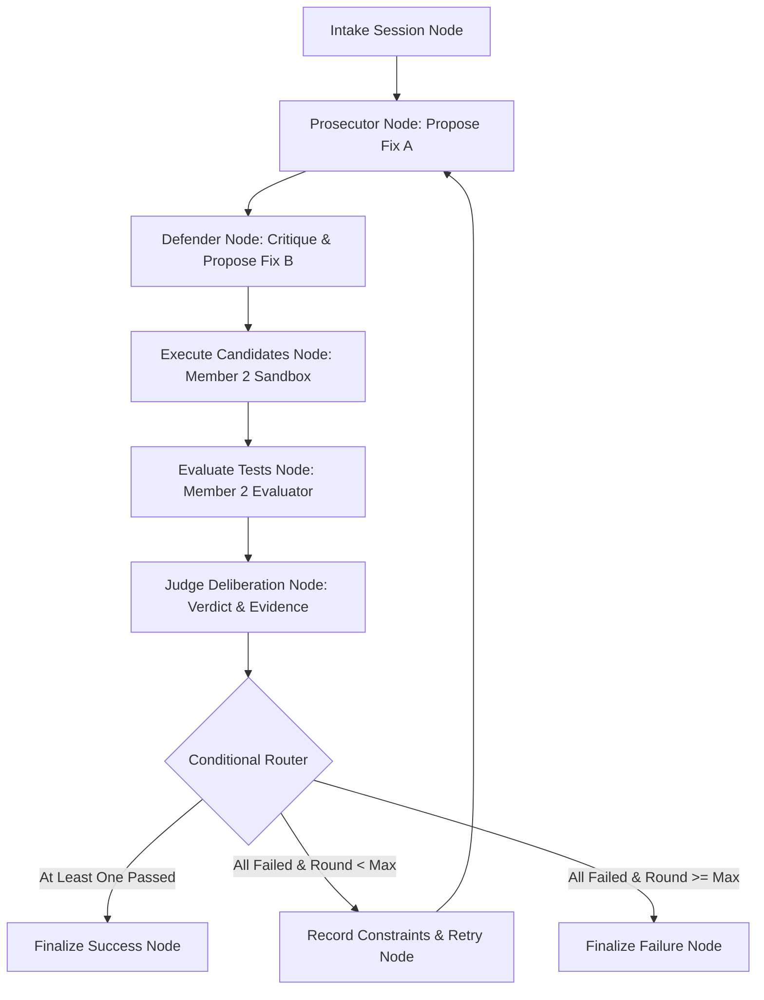

# Swarm Debugger — Backend Architecture & Foundation

Swarm Debugger is a multi-agent debugging courtroom system orchestrated using LangGraph and powered by local Ollama AI models (`qwen2.5-coder:7b`).

---

## 1. System Overview & Courtroom Metaphor

The system models bug resolution as an adversarial debate between distinct AI roles, decided deterministically by execution evidence:
- **Prosecutor (Member 1):** Analyzes the reported bug, formulates the initial accusation, and proposes Fix A.
- **Defender (Member 1):** Critiques the Prosecutor's diagnosis and independently proposes Fix B.
- **Judge (Member 1):** Synthesizes empirical evidence and explains the verdict using deterministic test results.
- **Sandbox & Evaluator (Member 2):** Executes candidates in an isolated environment and parses real test outcomes.
- **Constraint Ledger (Member 2):** Records rejected fixes and failure evidence to prevent recurring mistakes in subsequent retry rounds.
- **Courtroom Visualizer (Streamlit):** Subscribes to real execution events published by the backend.

---

## 2. Team Division & Ownership Boundaries

| Module Path | Owner | Description | Status in Foundation |
| :--- | :--- | :--- | :--- |
| `app/agents/` | **Member 1** | Prosecutor, Defender, and Judge agent prompt & LLM logic | Scaffolding (signatures & prompt builders defined) |
| `app/orchestration/` | **Member 1** | LangGraph workflow state, transition nodes, and routing | Functional state & routing; graph scaffolding |
| `app/schemas/` | **Member 1** | Shared Pydantic data contracts and inter-member interfaces | Functional & fully validated |
| `app/events/` | **Member 1** | Framework-independent workflow event publishing | Functional (`InMemoryEventPublisher`, `ConsoleEventPublisher`) |
| `app/config.py` | **Member 1** | Local Ollama and workflow configuration | Functional |
| `sandbox/` | **Member 2** | Restricted sandbox execution runner | Defined via `ISandboxRunner` contract |
| `evaluation/` | **Member 2** | Deterministic test parsing and result generator | Defined via `IEvaluator` contract |
| `memory/` | **Member 2** | Constraint Ledger and SQLite persistence | Defined via `IConstraintLedger` contract |

---

## 3. Agreed Inter-Member Interfaces

Defined in [`app/schemas/interfaces.py`](app/schemas/interfaces.py):

### A. Sandbox Runner Interface (`Member 2`)
- **Input:** `SandboxExecutionRequest`
  - `session_id: str`
  - `round_number: int`
  - `patch: CandidatePatch` (validated candidate patch)
  - `test_suite: str` (deterministic test script)
  - `timeout_seconds: float` (default 30.0s)
- **Output:** `SandboxExecutionEvidence`
  - `patch_id: str`
  - `stdout: str`
  - `stderr: str`
  - `exit_code: int`
  - `is_timeout: bool`
  - `execution_time_seconds: float`

### B. Test Evaluator Interface (`Member 2`)
- **Input:** `SandboxExecutionEvidence` + `test_suite: str`
- **Output:** `TestResult`
  - `status: TestExecutionStatus` (`PASSED`, `FAILED`, `TIMEOUT`, `INFRASTRUCTURE_ERROR`, `NOT_RUN`)
  - `passed: bool` (strictly `True` only if all tests pass with `exit_code == 0`)
  - `test_cases: List[TestCaseResult]`
  - `stdout: str`, `stderr: str`, `exit_code: Optional[int]`

### C. Constraint Ledger Interface (`Member 2`)
- **Input on Failure:** `ConstraintRecord`
  - `session_id: str`
  - `round_number: int`
  - `agent_role: AgentRole`
  - `patch_id: str`
  - `rejected_code: str`
  - `failure_reason: str`
  - `test_stderr: str`
- **Query for Subsequent Rounds:** `get_active_constraints(session_id: str) -> List[ConstraintRecord]`
  - Injected directly into Prosecutor and Defender prompts in rounds 2+ to forbid repeated invalid strategies.

---

## 4. Planned Workflow Graph Architecture



### Conditional Edge Decisions
- **`FINISH_SUCCESS`**: If any candidate patch passed deterministically (`status == PASSED` and `exit_code == 0`), proceed to `finalize_success`.
- **`RETRY_ROUND`**: If all candidate patches failed and `current_round < max_rounds`, persist failure to Member 2's Constraint Ledger, increment round, and loop back to Prosecutor.
- **`MAX_ROUNDS_EXCEEDED`**: If retry limit is reached, terminate with `max_rounds_reached`.
- **`TERMINATE_ERROR`**: If unexpected infrastructure/environment error occurred, fail gracefully.
- *Strict Rule:* Missing, unrun, or timed-out test results are **never** treated as success.

---

## 5. Event Publishing for Courtroom Visualizer

The orchestration emits actual events during execution via `BaseEventPublisher`:
- `session_started`: Session initiated with bug details.
- `agent_started`: Agent role (prosecutor/defender/judge) activated.
- `patch_proposed`: Candidate patch offered with diagnosis.
- `execution_started`: Candidates sent to sandbox.
- `tests_completed`: Test runner results recorded.
- `verdict_created`: Judge ruling synthesized.
- `constraint_recorded`: Rejected fix logged to ledger.
- `retry_started`: Next courtroom debate round initiated.
- `session_completed`: Clean resolution achieved.
- `session_failed`: Session aborted or max retries exhausted.

---

## 6. Project Structure

```
backend/
├── app/
│   ├── __init__.py
│   ├── config.py                  # Local Ollama & workflow settings
│   ├── main.py                    # Verification and health status entry point
│   ├── agents/
│   │   ├── __init__.py
│   │   ├── prosecutor.py          # Prosecutor role scaffolding
│   │   ├── defender.py            # Defender role scaffolding
│   │   └── judge.py               # Judge role scaffolding
│   ├── orchestration/
│   │   ├── __init__.py
│   │   ├── state.py               # WorkflowState TypedDict & initialization
│   │   ├── routing.py             # Conditional edge routing rules
│   │   └── graph.py               # Planned nodes, transitions, & graph builder
│   ├── schemas/
│   │   ├── __init__.py
│   │   ├── session.py             # DebugSession & SessionStatus
│   │   ├── patch.py               # CandidatePatch & AgentRole
│   │   ├── test_result.py         # TestResult, TestCaseResult, TestExecutionStatus
│   │   ├── events.py              # WorkflowEvent & WorkflowEventType
│   │   └── interfaces.py          # Member 1 / Member 2 boundary contracts
│   └── events/
│       ├── __init__.py
│       └── publisher.py           # InMemory & Console event publishers
├── tests/
│   ├── __init__.py
│   ├── test_config.py             # Config & env override tests
│   ├── test_events.py             # Event publish/subscribe tests
│   ├── test_orchestration.py      # State initialization and routing tests
│   └── test_schemas.py            # Pydantic validation & consistency tests
├── .env.example                   # Environment variable template
├── .gitignore                     # Git ignore rules
├── requirements.txt               # Dependencies
└── README.md                      # Documentation
```

---

## 7. Setup & Development Instructions

### Prerequisites
- Python 3.10+ (tested on Python 3.11)
- Ollama with local `qwen2.5-coder:7b` model:
  ```bash
  # In a separate terminal (when ready for inference):
  ollama run qwen2.5-coder:7b
  ```
  *(Note: No live Ollama connection is required to run the foundation tests).*

### Installation
```bash
cd backend
python -m venv .venv

# Windows Powershell
.venv\Scripts\Activate.ps1

# Linux / macOS
source .venv/bin/activate

pip install -r requirements.txt
```

### Environment Configuration
Copy `.env.example` to `.env` and adjust if needed:
```bash
cp .env.example .env
```

### Running Tests
```bash
python -m pytest tests -v
```

### Running Foundation Check
```bash
python app/main.py
```
